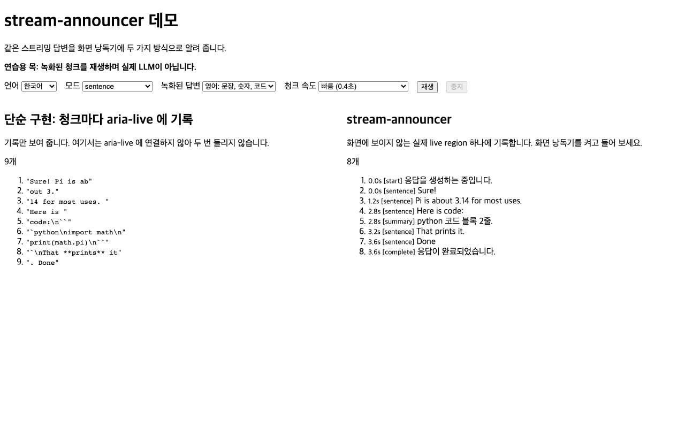
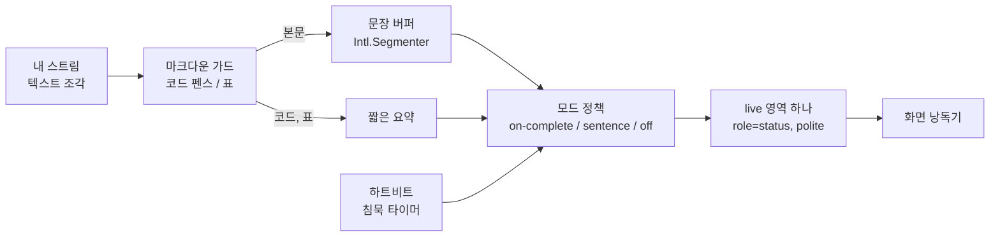
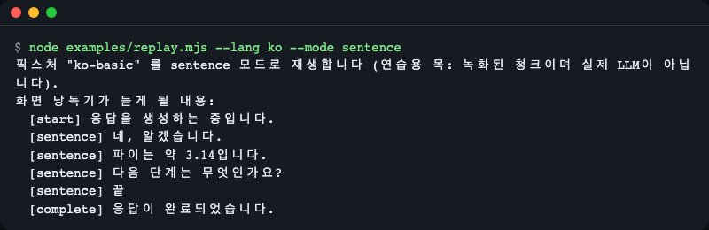
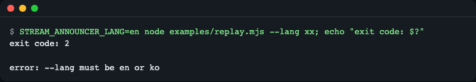
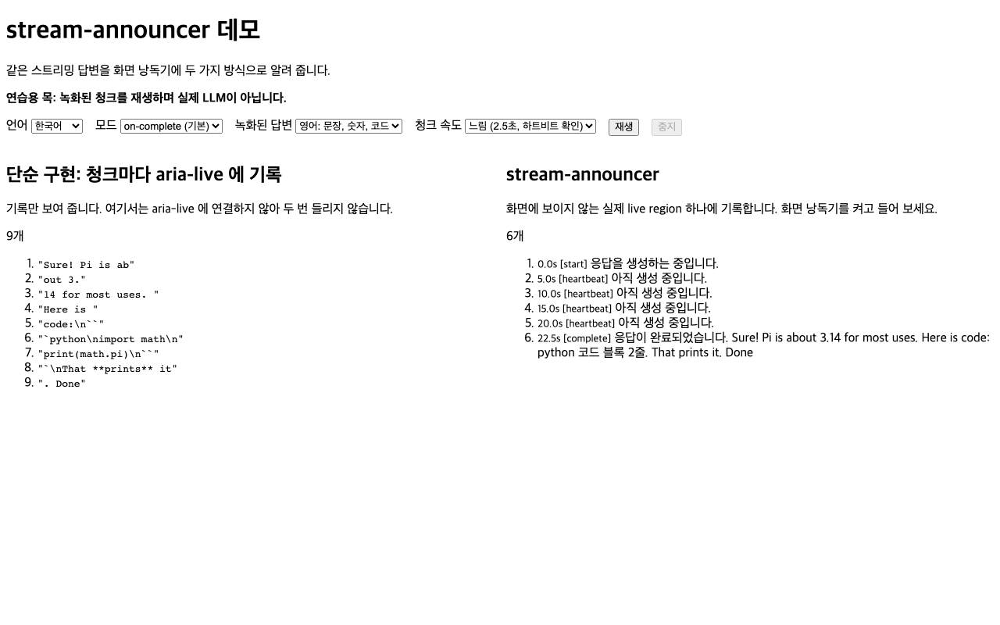
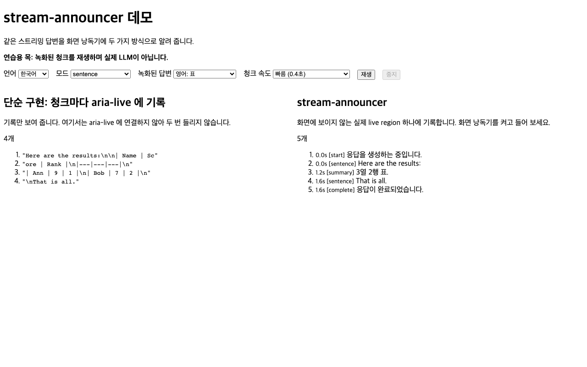
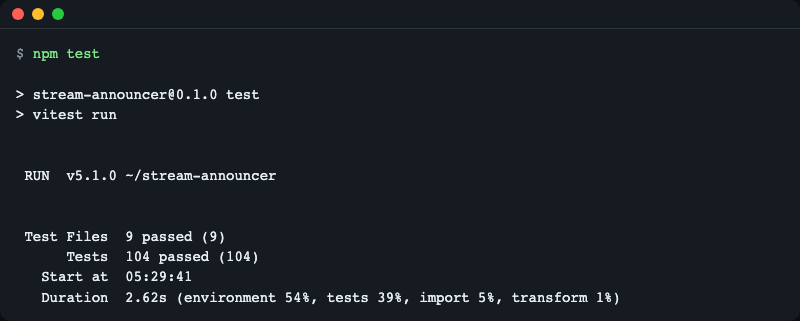

# stream-announcer

[English](README.md) | **한국어**

스트리밍 LLM 채팅을 위한 화면 낭독기 알림 라이브러리입니다. 스트리밍 응답의 텍스트 조각(delta)을 넘기면, 생성이 시작됐다는 것, 반쯤 쓰인 조각이 아닌 완성된 문장, 코드 블록·표의 요약, 응답이 완료·중단·실패했다는 것을 화면 낭독기 사용자에게 알려 줍니다. 프레임워크 중립 코어, React 훅, jsdom 테스트 헬퍼로 구성됩니다. TypeScript, 런타임 의존성 없음.



*같은 녹화 스트림입니다. 왼쪽: 모든 청크를 `aria-live` 요소에 그대로 썼을 때(원문 코드 포함). 오른쪽: stream-announcer 가 알리는 내용(문장, 코드 요약, 완료 메시지 한 번).*

## 왜 필요한가

토큰을 스트리밍하는 채팅 화면은 DOM 을 초당 5~20번 바꿉니다. 화면 낭독기 사용자에게는 두 가지 문제가 생깁니다.

- 메시지 영역을 `aria-live` 로 만들면, 낭독기가 `out 3.` 같은 반쯤 쓰인 조각을 계속 읽습니다.
- 아무것도 live 가 아니면, 생성이 시작됐는지·진행 중인지·끝났는지 알 수 없습니다.

`stream-announcer` 는 채팅 옆에 **미리 만들어 둔 별도의 상태 영역 하나**를 두고, 언제 무엇을 말할지 정합니다. 메시지 목록은 조용하게(`aria-live="off"`) 두고, 상태 영역만 말합니다.

## 설치

```bash
npm install stream-announcer
```

아직 npm 에서 보이지 않으면 GitHub 에서 설치하세요: `npm install github:LeeGyeongPil/stream-announcer` (설치할 때 스스로 빌드합니다).

- 예제·테스트는 Node 22.12 이상. 라이브러리 자체는 `Intl.Segmenter` 가 있는 브라우저면 동작합니다.
- 런타임 의존성 없음. `react`(18 이상)는 선택 peer 의존성이며 `stream-announcer/react` 를 쓸 때만 필요합니다.

## 빠르게 시작하기

바닐라 JS, DOM 불필요(직접 만든 `sink` 가 모든 문구를 받습니다. `sink` 가 없으면 라이브러리가 live 영역을 만듭니다):

```js
import { createStreamAnnouncer } from 'stream-announcer';

const announcer = createStreamAnnouncer({
  mode: 'sentence',
  sink: (text, meta) => console.log(`[${meta.kind}] ${text}`),
});

announcer.start();
for (const chunk of ['Sure! Pi is ab', 'out 3.', '14 for most uses. ', 'Here is ', 'code:\n``', '`python\nimport math\nprint(math.pi)\n``', '`\nThat **prints** it', '. Done']) {
  announcer.push(chunk);
}
announcer.done();
announcer.destroy();
```

```text
[start] Generating response.
[sentence] Sure!
[sentence] Pi is about 3.14 for most uses.
[sentence] Here is code:
[summary] python code block, 2 lines.
[sentence] That prints it.
[sentence] Done
[complete] Response complete.
```

일어나지 않은 일에 주목하세요. `3.` 과 `14` 는 잘리지 않았고, 청크 사이에서 갈라진 코드 펜스는 읽히지 않았으며, `**prints**` 의 별표는 사라졌습니다.

React:

```tsx
import { useEffect } from 'react';
import { useStreamAnnouncer } from 'stream-announcer/react';

function Chat({ chunks }: { chunks: string[] }) {
  const announcer = useStreamAnnouncer({ mode: 'on-complete' });
  useEffect(() => {
    announcer.start();
    for (const chunk of chunks) announcer.push(chunk);
    announcer.done();
  }, [announcer, chunks]);
  return <p>chat</p>;
}
```

`on-complete`(기본값)에서는 시작할 때 "Generating response." 를 한 번, 끝날 때 `Response complete. Hello world.` 를 한 번 듣습니다(텍스트 `['Hello ', 'world.']` 로 jsdom 테스트에서 확인).

이미 `status` 와 계속 늘어나는 텍스트를 갖고 있다면(예: AI SDK 의 `useChat`), `useAnnounceText({ text, status })` 가 `start`·`push`·`done` 호출을 대신해 줍니다.

## 핵심 개념



1. **마크다운 가드**는 스트림을 줄 단위로 읽습니다. 코드 펜스와 표는 읽지 않고 `python code block, 2 lines.`, `Table, 3 columns, 2 rows.` 같은 요약으로 바꿉니다. 청크 사이에서 갈라진 펜스도 처리합니다.
2. **문장 버퍼**는 청크를 모아 `Intl.Segmenter` 로 끊습니다. 마지막 미완성 조각은 보류해서 `3.` + `14` 가 한 숫자로 유지됩니다. 문장부호가 없는 텍스트는 `idleFlushMs`(sentence 모드)나 `maxChars` 가 지나면 내보냅니다.
3. **모드 정책**이 사용자에게 무엇이 전달될지 정합니다(아래 참고).
4. **하트비트**는 `heartbeatMs`(기본 5초) 동안 조용하면 "Still generating." 을 알립니다.
5. **live 영역 하나**는 첫 문구 전에 미리 만들어 둡니다(첫 문구와 동시에 추가된 영역은 낭독기가 무시합니다). 큐를 두어 각 문구가 `spacingMs`(기본 150ms) 동안 영역에 머문 뒤 다음 문구가 교체하므로, 같은 순간에 온 문구도 읽히기 전에 덮어쓰이지 않습니다. 같은 문구가 반복되면 영역을 비운 뒤 100ms 후 다시 써서 다시 읽히게 합니다.

### 모드

| 모드 | 사용자가 듣는 것 |
|---|---|
| `on-complete`(기본) | "Generating response.", 5초 침묵마다 하트비트, 끝에서 한 번 "Response complete." 와 본문 전체(코드·표는 요약) |
| `sentence` | 시작 문구, 이어서 완성된 문장과 요약이 나오는 대로, 그리고 "Response complete." 하트비트는 침묵일 때만 울립니다 |
| `off` | 시작 문구와 마지막 상태(완료·중단·실패)만. 하트비트·본문 없음 |

`on-complete` 가 기본인 이유는 live 영역을 가장 적게 바꾸기 때문입니다. 응답이 쓰이는 동안 따라 듣고 싶은 사용자가 있다면 `sentence` 를 쓰세요.

### 처리하는 것

- **반쯤 쓰인 문장**: 문장이 끝날 때까지 보류합니다([핵심 개념](#핵심-개념) 2).
- **코드 블록과 표**: 펜스가 청크 사이에서 갈라져도 짧은 요약으로 바꿉니다(핵심 개념 1).
- **침묵**: `heartbeatMs` 뒤에 "Still generating." 하트비트. 문장이 계속 나오는 동안은 울리지 않습니다(핵심 개념 4).
- **같은 문구 반복**: 비우고 다시 써서 다시 읽히게 합니다(핵심 개념 5).
- **한꺼번에 온 여러 문구**: 하나의 큐에서 `spacingMs` 간격으로 순서대로 냅니다(핵심 개념 5).
- **live 영역은 하나만**: 첫 문구 전에 만들어 두어 낭독기가 지켜봅니다(핵심 개념 5).
- **`aria-busy`**: 메시지 컨테이너에 붙이는 선택 힌트([사용 예](#3-바쁜-컨테이너-표시) 3).
- **정리**: `destroy()`(또는 React 훅 언마운트)가 모든 타이머를 멈춥니다. announcer 가 직접 만든 영역은 제거하고, `region` 옵션으로 공유한 영역은 남겨 둡니다(자기 대기 문구만 버립니다).

## API

`stream-announcer` 전체:

| 이름 | 하는 일 | 주요 인자 | 반환 |
|---|---|---|---|
| `createStreamAnnouncer(options?)` | 응답 하나씩 처리하는 상태 기계를 만든다 | `mode`, `locale`, `messages`, `heartbeatMs`(5000), `includeBodyOnComplete`(true), `minChars`(4), `maxChars`(200), `idleFlushMs`(1500, sentence 모드), `announceReasoning`, `announceTools`, `sink`, `region`, `busyTarget`, `document` (`sink` 와 `region` 은 함께 줄 수 없음: `TypeError`) | `StreamAnnouncer` |
| `announcer.start()` | 응답을 시작한다. 끝나지 않은 이전 응답은 버린다 | 없음 | `void` |
| `announcer.push(delta)` | 다음 텍스트 조각을 넘긴다(문자열, 생성 중이 아니면 무시) | `delta: string` | `void` |
| `announcer.event(e)` | `{ type: 'reasoning' }` 또는 `{ type: 'tool-call', name }` 을 알린다. 옵션으로 켜지 않으면 조용하다 | `StreamEvent` | `void` |
| `announcer.done()` / `abort()` / `error(err?)` | 응답을 완료·중단·실패로 끝낸다 | 없음 | `void` |
| `announcer.destroy()` | 타이머를 정리하고 자기가 만든 영역을 제거한다(공유 `region` 은 남기고 자기 대기 문구만 버린다). 이후 `destroy` 외 호출은 예외 | 없음 | `void` |
| `announcer.status` | `idle`, `generating`, `done`, `aborted`, `error` | 없음 | `AnnouncerStatus` |
| `createLiveRegion(options?)` | 화면에서 숨긴 `role="status"` 영역 하나를 만든다 | `document`, `politeness`(`polite`), `repeatDelayMs`(100), `spacingMs`(150) | `LiveRegion`(`element`, `announce`, `clear(owner?)`, `destroy`) |
| `SentenceBuffer` | 문장 분리기만 따로 쓴다 | `locale`, `minChars`, `maxChars`, `idleFlushMs`, `onIdle` | 클래스 |
| `MarkdownGuard` | 코드 펜스·표 감지기만 따로 쓴다 | `messages` | 클래스 |
| `stripInlineMarkdown(text)` | `**`, `` ` ``, 링크 같은 기호를 없앤다 | `text: string` | `string` |
| `messages`, `pickLanguage(locale)`, `resolveMessages(locale, overrides)` | 내장 문구와 언어 선택 | `locale`, `overrides` | 문구 / `'en' \| 'ko'` |

`stream-announcer/react`:

| 이름 | 하는 일 | 반환 |
|---|---|---|
| `useStreamAnnouncer(options?)` | 컴포넌트 수명 동안 쓰는 announcer 하나. 옵션은 마운트 때 한 번만 읽는다(새 옵션은 `key` 를 바꿔 적용). 마운트 전 호출은 무시 | `StreamAnnouncer` |
| `useAnnounceText({ text, status, stopped?, ...options })` | 늘어나는 `text` 와 `status`(`idle`, `submitted`, `streaming`, `ready`, `error`)로 announcer 를 구동한다 | `void` |

`stream-announcer/testing`:

| 이름 | 하는 일 | 반환 |
|---|---|---|
| `memorySink()` | 문구를 기록하는 sink(`history`, 종류·시각이 있는 `entries`, `clear()`) | `MemorySink` |
| `recordLiveRegion(element)` | MutationObserver 레코드로 live 영역에 쓰인 내용을 모두 기록한다(jsdom 이나 브라우저 DOM 필요) | `{ texts(), stop() }` |
| `replay(announcer, chunks, { intervalMs?, end? })` | 청크를 스트림처럼 넣고 `done`·`abort`·`error` 로 끝낸다 | `Promise<void>` |
| `naiveAnnounce(chunks, { document? })` | 비교 기준선: 모든 청크를 평범한 `aria-live` 요소에 그대로 붙인다 | `string[]` |

`AnnounceKind`, `AnnounceMeta`, `AnnounceMode`, `AnnounceSink`, `AnnouncerStatus`, `StreamEvent`, `StreamAnnouncerOptions`, `AnnouncerMessages` 같은 타입도 내보냅니다.

## 사용 예

### 1. 문구와 언어

영어·한국어 문구가 내장돼 있습니다. `locale: 'ko'`(또는 `ko-KR`)면 한국어, 그 외는 영어입니다. 문구는 일부만 덮어쓸 수 있습니다.

```js
import { createStreamAnnouncer } from 'stream-announcer';

const announcer = createStreamAnnouncer({
  mode: 'sentence',
  messages: {
    generating: 'Assistant is typing.',
    codeBlock: ({ lang, lines }) => `Code sample in ${lang || 'plain text'}, ${lines} lines, skipped.`,
  },
  sink: (text, meta) => console.log(`[${meta.kind}] ${text}`),
});

announcer.start();
announcer.push('Try this:\n```js\nconsole.log(1)\nconsole.log(2)\n```\nDone.');
announcer.done();
announcer.destroy();
```

```text
[start] Assistant is typing.
[sentence] Try this:
[summary] Code sample in js, 2 lines, skipped.
[sentence] Done.
[complete] Response complete.
```

한국어, 기본 `on-complete` 모드입니다. 본문은 한 번에 전달되고 `3.14` 는 잘리지 않습니다.

```js
import { createStreamAnnouncer } from 'stream-announcer';

const announcer = createStreamAnnouncer({
  locale: 'ko',
  sink: (text, meta) => console.log(`[${meta.kind}] ${text}`),
});

announcer.start();
announcer.push('네, 알겠습니');
announcer.push('다. 파이는 약 3.');
announcer.push('14입니다.');
announcer.done();
announcer.destroy();
```

```text
[start] 응답을 생성하는 중입니다.
[complete] 응답이 완료되었습니다. 네, 알겠습니다. 파이는 약 3.14입니다.
```

### 2. 채팅 UI 테스트

`stream-announcer/testing` 으로 화면 낭독기 없이 무엇이 어떤 순서로 알려지는지 단언할 수 있습니다(vitest 예시, 다른 러너도 됩니다).

```ts
import { expect, test } from 'vitest';
import { createStreamAnnouncer } from 'stream-announcer';
import { memorySink, replay } from 'stream-announcer/testing';

test('announces sentences, summarizes code, never reads raw code', async () => {
  const sink = memorySink();
  const announcer = createStreamAnnouncer({ mode: 'sentence', sink });
  await replay(announcer, ['Sure! Pi is ab', 'out 3.', '14. Here is code:\n``', '`python\nimport math\n``', '`\nDone.']);
  expect(sink.history).toEqual([
    'Generating response.',
    'Sure!',
    'Pi is about 3.14.',
    'Here is code:',
    'python code block, 1 line.',
    'Done.',
    'Response complete.',
  ]);
  announcer.destroy();
});
```

실제 DOM 영역을 확인하려면 응답을 시작하기 전에 `recordLiveRegion(document.querySelector('[role="status"]'))` 를 호출하세요(jsdom 환경 필요). `textContent` 를 한 번만 읽으면 배치된 마지막 값만 보이기 때문에, MutationObserver 레코드를 하나씩 읽습니다.

### 3. 바쁜 컨테이너 표시

`busyTarget` 을 넘기면 응답이 생성되는 동안 메시지 컨테이너에 `aria-busy="true"` 가 붙습니다. 힌트일 뿐이며 낭독기마다 해석이 달라서 상태 영역은 이것에 의존하지 않습니다.

## 데모와 Node 예제 해 보기

둘 다 **연습용 목(mock)** 입니다. 실제 LLM 이 아니라 녹화된 청크를 재생하므로 오프라인으로 돌고 API 키가 필요 없습니다.

```bash
git clone https://github.com/LeeGyeongPil/stream-announcer.git
cd stream-announcer
npm ci
npm run example -- --lang ko --mode sentence
```

```text
픽스처 "ko-basic" 를 sentence 모드로 재생합니다 (연습용 목: 녹화된 청크이며 실제 LLM이 아닙니다).
화면 낭독기가 듣게 될 내용:
  [start] 응답을 생성하는 중입니다.
  [sentence] 네, 알겠습니다.
  [sentence] 파이는 약 3.14입니다.
  [sentence] 다음 단계는 무엇인가요?
  [sentence] 끝
  [complete] 응답이 완료되었습니다.
```



*Node 예제는 브라우저 없이 낭독 순서를 출력합니다.*

옵션(`node examples/replay.mjs --help`): `--lang en|ko`, `--mode sentence|on-complete|off`, `--fixture <이름>`(`en-basic`, `ko-basic`, `table`, `unpunctuated-ko`), `--interval <ms>`. 출력 언어는 `--lang` > `STREAM_ANNOUNCER_LANG` > `LC_ALL` > `LC_MESSAGES` > `LANG` 순이며 한국어가 아니면 영어입니다. 잘못된 값은 분명히 실패합니다.

```text
$ STREAM_ANNOUNCER_LANG=ko node examples/replay.mjs --lang xx; echo "exit code: $?"
error: --lang 값은 en 또는 ko 여야 합니다
exit code: 2
```



*잘못된 언어 값은 종료 코드 2 로 거부됩니다(스크린샷은 영어 출력 설정(`STREAM_ANNOUNCER_LANG=en`)으로 찍어서 오류 문구가 영어이고, 터미널이 두 스트림을 합치는 순서 때문에 `exit code` 줄이 먼저 보입니다. 위 텍스트 블록이 한국어 출력의 실제 순서입니다).*

`on-complete` 모드의 표:

```text
$ node examples/replay.mjs --lang en --mode on-complete --fixture table
Replaying fixture "table" in on-complete mode (practice mock: recorded chunks, not a real LLM).
A screen reader would hear:
  [start] Generating response.
  [complete] Response complete. Here are the results: Table, 3 columns, 2 rows. That is all.
```

데모 페이지(Vite, 127.0.0.1 에 바인딩)는 두 로그를 나란히 보여 줍니다.

```bash
npm run demo
```

모드, 녹화된 응답, 속도를 고르고 Replay 를 누르세요. 왼쪽 로그는 단순한 방식, 오른쪽 로그는 stream-announcer 가 알리는 내용이며 항목마다 시각과 종류가 붙습니다. 언어 메뉴(English / 한국어)는 맨 위에 있고, `?lang=ko` 로도 정할 수 있으며, 선택은 저장되고, 브라우저 언어 감지는 첫 방문에만 합니다. 느린 속도(청크당 2.5초)를 고르면 하트비트가 보입니다.

주소로 시작 상태를 정할 수도 있습니다. `?mode=on-complete|sentence|off`, `?fixture=en-basic|ko-basic|table`, `?speed=fast|slow`, `?lang=en|ko`, `?autoplay=1`(열자마자 한 번 재생). 잘못된 값은 무시합니다. 예: `?mode=sentence&fixture=table&autoplay=1`.



*느린 속도의 `on-complete` 모드(`?mode=on-complete&speed=slow&autoplay=1`): 시작 문구 한 번, 침묵 중 하트비트, 끝에서 본문 한 번.*



*표는 짧은 요약이 됩니다(`?mode=sentence&fixture=table&autoplay=1`). 코드 블록도 첫 번째 그림처럼 같은 방식으로 요약되며, 원문 코드는 읽히지 않습니다.*


*데모 페이지 상단의 언어 메뉴와 조작 요소.*

## 실제 화면 낭독기로 확인하기(수동 체크리스트)

자동 테스트(jsdom)가 증명하는 것은 **영역에 무엇이, 어떤 순서와 시각으로 쓰였는가**입니다. 특정 낭독기가 그것을 어떻게 말하는지는 증명하지 못합니다. 배포 전에 지원하는 조합마다 한 번씩 확인하세요. 아직 이 문서에 기록된 확인 결과는 없으니, 여러분의 UI 로 직접 확인하세요.

| 조합 | 시작 문구 | 하트비트(10초 대기) | 완료 한 번 | 코드·표 요약 | 중지 버튼 |
|---|---|---|---|---|---|
| NVDA + Firefox | [ ] | [ ] | [ ] | [ ] | [ ] |
| NVDA + Chrome | [ ] | [ ] | [ ] | [ ] | [ ] |
| VoiceOver + Safari | [ ] | [ ] | [ ] | [ ] | [ ] |
| JAWS + Chrome | [ ] | [ ] | [ ] | [ ] | [ ] |

무엇을 들어야 하나:

1. 전송을 누르면 시작 문구를 한 번 듣고, 답변 내용은 아직 듣지 않는다(`on-complete`).
2. 느린 답변을 계속 기다리면 "Still generating." 이 약 5초마다 나오고, 그보다 자주 나오지 않는다.
3. 답변이 끝나면 "Response complete." 와 본문이 조각 없이 정확히 한 번 나온다.
4. 코드가 있는 답변은 요약("python code block, 2 lines.")만 나오고 코드를 한 글자씩 읽지 않는다.
5. 응답 도중 중지를 누르면 "Response stopped." 가 한 번 나오고 이후엔 조용하다(늦은 하트비트 없음).
6. 포커스를 메시지 목록으로 옮겨 읽으면 읽기 키로 메시지를 그대로 읽을 수 있다.

## 언제 쓰나

- 잘 맞는 경우: 직접 LLM 채팅 UI 를 만들고(순수 React, AI SDK 의 `useChat`, assistant-ui, 또는 프레임워크 없이) 버퍼링·정리 코드를 직접 짜지 않고 문장 단위·완료 인지 알림을 넣고 싶을 때.
- 다른 도구가 나은 경우: "저장됨" 같은 고정 문구만 알리면 될 때 → [`@react-aria/live-announcer`](https://www.npmjs.com/package/@react-aria/live-announcer), [`react-aria-live`](https://www.npmjs.com/package/react-aria-live), [`@github/arianotify-polyfill`](https://github.com/github/ariaNotify-polyfill). 이들은 받은 문구를 알릴 뿐 토큰 스트림을 문장으로 바꾸지 않습니다. `stream-announcer` 는 `sink` 옵션으로 이들을 출력 수단으로 쓸 수도 있습니다.
- 범위 밖: 음성 합성. 화면 낭독기 사용자는 이미 자기 음성이 있어서 그 위에 따로 말하면 충돌합니다.

## 알려진 한계

- **jsdom 은 화면 낭독기가 아닙니다.** 위 체크리스트를 보세요. NVDA·JAWS·VoiceOver 는 동작이 다릅니다(예: 같은 문구 반복이나 빠른 연속 갱신을 처리하는 방식).
- **아주 빠른 연속 문구.** 영역은 한 번에 한 문구만 쓰고 각 문구를 `spacingMs`(150ms) 동안 유지하므로, 한꺼번에 쌓인 문구는 사라지지 않고 시간차로 나옵니다. 그래서 긴 묶음은 끝나기까지 시간이 걸리고(10개면 약 1.5초), 낭독 중에 교체된 문구는 낭독기가 건너뛰거나 끊을 수 있습니다. 문구가 끊긴다면 `spacingMs` 를 늘리거나, 본문을 한 번에 보내는 `on-complete` 모드를 쓰세요.
- **개발 모드의 React StrictMode.** `useStreamAnnouncer` 는 announcer 를 생성·파기하는 쌍으로 다루므로 StrictMode 의 이중 마운트 뒤에도 영역은 정확히 하나입니다. 다만 `useAnnounceText` 를 처음부터 `submitted` 상태로 렌더하면, 개발 모드에서만 일어나는 이중 마운트 때문에 직접 만든 `sink` 로 시작 문구가 두 번 갑니다(영역은 여전히 하나). 보통 상태는 `idle` 이나 `ready` 로 시작하므로 영향이 없고, 프로덕션 빌드는 이중 마운트하지 않습니다.
- **문장 감지는 휴리스틱입니다.** `Intl.Segmenter` 는 약어(`Dr. Smith`)나 목록 번호(`1. First`) 뒤에서 끊을 수 있습니다. 짧은 조각은 합치고(`minChars`), 문장부호 없는 텍스트는 `idleFlushMs` 와 `maxChars` 로 내보냅니다.
- **들여쓰기 코드 블록은 감지하지 않습니다.** 펜스(```` ``` ```` 또는 `~~~`) 블록만 요약합니다.
- **`aria-busy` 는 힌트일 뿐입니다.** 낭독기마다 의미를 다르게 해석합니다.
- `useStreamAnnouncer` 의 옵션은 마운트 때 한 번만 읽습니다.

## 한 문단으로 보는 동작 원리

`start()` 는 모든 것을 초기화하고 시작 문구를 알립니다. 모든 `push()` 는 마크다운 가드(열린 코드 펜스·표를 붙잡고 줄 수만 셉니다)를 지나 문장 버퍼(마지막 미완성 조각을 보류합니다)로 갑니다. 완성된 조각은 순서대로 하나뿐인 live 영역의 큐에 들어가 각각 `spacingMs` 동안 유지됩니다. 하트비트는 알림이 있을 때마다 다시 거는 타이머라서 실제로 조용할 때만 울립니다. `done()` 은 큐에 남은 문장을 모두 읽힌 뒤 완료 문구를 알립니다. `abort()` 와 `error()` 는 큐에 남은 문구를 버리고 종료 문구("Response stopped." / "Response failed.")만 알립니다. `start()` 를 다시 부르면 이전 응답의 대기 문구를 버립니다. 세 경우 모두 타이머를 멈춥니다. 기본 영역은 announcer 가 비워 줍니다. 출력을 늦추는 커스텀 `sink` 는 `meta.kind` 가 `start`·`abort`·`error` 일 때 자기 큐를 직접 비워야 합니다(`LiveRegion` 을 쓰면 `region.clear()` 호출). `clear(owner?)` 는 아직 기다리는 문구만 버리고 이미 쓰인 문구는 두며, 여러 announcer 가 `region` 을 공유하면 각자 자기 문구만 버립니다.

## 버전

[SemVer](https://semver.org/lang/ko/)를 따릅니다. 0.x 동안은 마이너 버전에서 API 가 바뀔 수 있으며, 바뀐 내용은 [CHANGELOG.md](CHANGELOG.md)에 적습니다.

## 개발

```bash
npm ci
npm run typecheck
npm test
npm run build
```

`npm test` 는 jsdom 과 녹화된 청크로 9개 파일의 테스트 108개를 실행합니다(작성자 환경에서 약 2.5초). 브라우저·키·네트워크가 필요 없습니다.



*테스트는 위에서 설명한 동작마다 낭독 순서를 단언합니다.*

## 배경과 출처

2026-11-14 확인:

- [Making immersive LLM chat experiences more accessible (Smashing Magazine)](https://smashingmagazine.com/2026/11/making-immersive-llm-chat-experiences-more-accessible/): 상태 영역 하나, 완료 시 알림, 약 5초 뒤 로딩 문구, 코드·표 요약.
- [Accessible streaming chat UI (azukiazusa)](https://azukiazusa.dev/en/blog/accessible-streaming-chat-ui): 조각 낭독, `aria-busy`·`aria-relevant` 지원 차이, 미리 존재하는 영역, 같은 문구 다시 쓰기.
- [WAI-ARIA 1.2 의 `aria-busy`](https://www.w3.org/TR/wai-aria-1.2/#aria-busy)
- [`Intl.Segmenter` (MDN)](https://developer.mozilla.org/en-US/docs/Web/JavaScript/Reference/Global_Objects/Intl/Segmenter)

## 라이선스

MIT.
