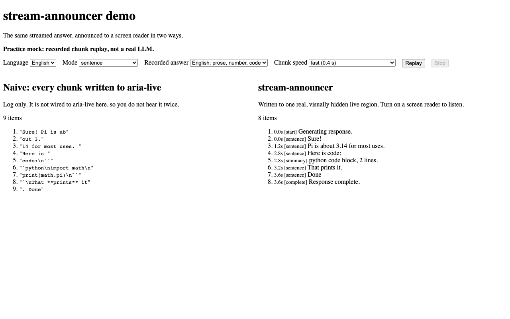
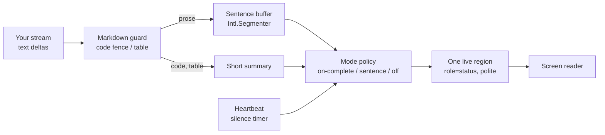
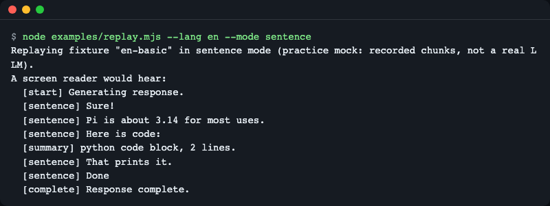
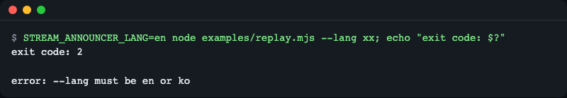
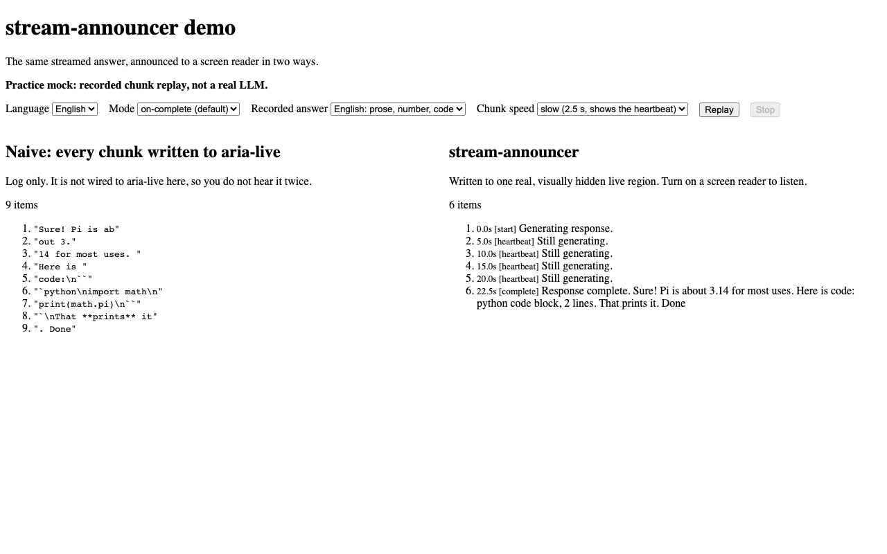
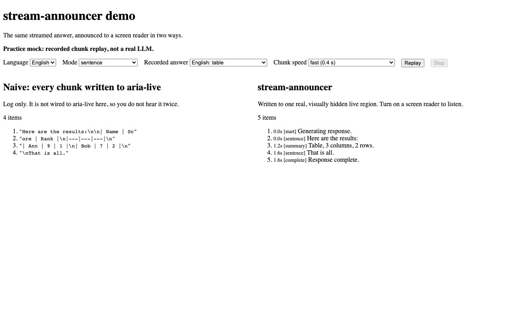
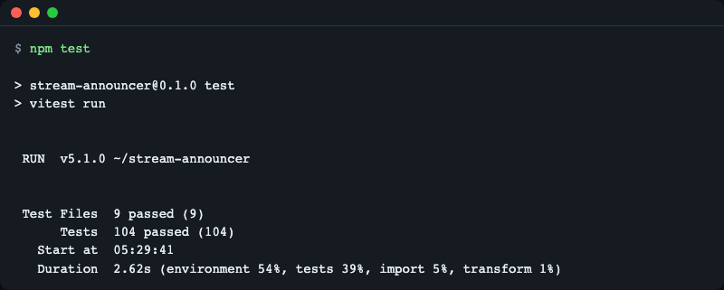

# stream-announcer

**English** | [한국어](README.ko.md)

Screen reader announcements for streaming LLM chat. You feed it the text deltas of a streaming response; it tells screen reader users when generation started, reads finished sentences instead of half-written fragments, summarizes code blocks and tables, and says when the response is complete, stopped, or failed. A framework-neutral core, React hooks, and jsdom test helpers. TypeScript, no runtime dependencies.



*The same recorded stream. Left: every chunk written straight to an `aria-live` element, including the raw code. Right: what stream-announcer announces (sentences, a code summary, one completion message).*

## Why

A chat UI that streams tokens changes the DOM five to twenty times a second. Two things go wrong for screen reader users:

- If the message container is an `aria-live` region, the screen reader reads half-written fragments such as `out 3.` or `` code:\n`` ``, over and over.
- If nothing is live, users never learn that generation started, is still running, or has finished.

`stream-announcer` puts **one separate, pre-created status region** next to your chat and decides when and what it says. Your message list stays silent (`aria-live="off"`); the status region does the talking.

## Install

```bash
npm install stream-announcer
```

Until the package appears on the npm registry for you, install from GitHub: `npm install github:LeeGyeongPil/stream-announcer` (the package builds itself on install).

- Node 22.12+ for the examples and tests; the library itself runs in any browser with `Intl.Segmenter`.
- No runtime dependencies. `react` (18+) is an optional peer dependency, needed only for `stream-announcer/react`.

## Quick start

Vanilla, no DOM needed (a custom `sink` receives every text; without one, the library creates the live region for you):

```js
import { createStreamAnnouncer } from 'stream-announcer';

const announcer = createStreamAnnouncer({
  mode: 'sentence',
  sink: (text, meta) => console.log(`[${meta.kind}] ${text}`),
});

announcer.start();
for (const chunk of ['Sure! Pi is ab', 'out 3.', '14 for most uses. ', 'Here is ', 'code:\n``', '`python\nimport math\nprint(math.pi)\n``', '`\nThat **prints** it', '. Done']) {
  announcer.push(chunk);
}
announcer.done();
announcer.destroy();
```

```text
[start] Generating response.
[sentence] Sure!
[sentence] Pi is about 3.14 for most uses.
[sentence] Here is code:
[summary] python code block, 2 lines.
[sentence] That prints it.
[sentence] Done
[complete] Response complete.
```

Notice what did not happen: `3.` / `14` was not split, the code fence that was cut across chunks was never read aloud, and `**prints**` lost its asterisks.

React:

```tsx
import { useEffect } from 'react';
import { useStreamAnnouncer } from 'stream-announcer/react';

function Chat({ chunks }: { chunks: string[] }) {
  const announcer = useStreamAnnouncer({ mode: 'on-complete' });
  useEffect(() => {
    announcer.start();
    for (const chunk of chunks) announcer.push(chunk);
    announcer.done();
  }, [announcer, chunks]);
  return <p>chat</p>;
}
```

With `on-complete` (the default) the user hears "Generating response." at the start and one `Response complete. Hello world.` at the end (checked in a jsdom test with the text `['Hello ', 'world.']`).

If you already track a `status` and the growing text (for example from the AI SDK's `useChat`), `useAnnounceText({ text, status })` calls `start`, `push` and `done` for you.

## Concepts



1. **Markdown guard** reads the stream line by line. A code fence or a table is never spoken; it becomes `python code block, 2 lines.` or `Table, 3 columns, 2 rows.` A fence split across chunks is handled.
2. **Sentence buffer** collects chunks and cuts them with `Intl.Segmenter`. The last, unfinished piece is held back, so `3.` + `14` stays one number. Text without punctuation is released after `idleFlushMs` (sentence mode) or `maxChars`.
3. **Mode policy** decides what reaches the user (see below).
4. **Heartbeat** says "Still generating." after `heartbeatMs` of silence (default 5 s).
5. **One live region**, created before the first text (screen readers ignore regions that are added at the same moment as their first message), with a queue: each text stays in the region for `spacingMs` (150 ms by default) before the next one replaces it, so texts that arrive in the same moment are not overwritten before they can be read, and identical texts are cleared and re-written 100 ms later so they are announced again.

### Modes

| Mode | What the user hears |
|---|---|
| `on-complete` (default) | "Generating response.", a heartbeat every 5 s of silence, then once at the end "Response complete." followed by the whole body (code and tables as summaries) |
| `sentence` | The start text, then each finished sentence and summary as it appears, then "Response complete." The heartbeat only fires during silence |
| `off` | Only the start text and the final status (complete, stopped, failed). No heartbeat, no body |

`on-complete` is the default because it changes the live region the least. Use `sentence` if users want to follow along while the response is written.

### What it handles

- **Half-written sentences**: held back until a sentence is finished ([Concepts](#concepts) 2).
- **Code blocks and tables**: replaced by a short summary, even when the fence is split across chunks (Concepts 1).
- **Silence**: a "Still generating." heartbeat after `heartbeatMs`, never while sentences keep coming (Concepts 4).
- **Repeated identical text**: cleared and re-written so it is announced again (Concepts 5).
- **Several texts at once**: spaced `spacingMs` apart in one queue, in order (Concepts 5).
- **One region only**: created before the first text, so screen readers watch it (Concepts 5).
- **`aria-busy`**: optional hint on your message container ([Usage](#3-mark-the-busy-container) 3).
- **Cleanup**: `destroy()` (or unmounting the React hook) clears all timers. It removes the region the announcer created itself; a region shared through the `region` option is left in place (only the announcer's own waiting texts are dropped).

## API

All of `stream-announcer`:

| Name | What it does | Main arguments | Returns |
|---|---|---|---|
| `createStreamAnnouncer(options?)` | Creates the state machine for one response at a time | `mode`, `locale`, `messages`, `heartbeatMs` (5000), `includeBodyOnComplete` (true), `minChars` (4), `maxChars` (200), `idleFlushMs` (1500, sentence mode), `announceReasoning`, `announceTools`, `sink`, `region`, `busyTarget`, `document` (pass `sink` or `region`, not both: `TypeError`) | `StreamAnnouncer` |
| `announcer.start()` | Begins a response; discards an unfinished previous one | none | `void` |
| `announcer.push(delta)` | Feeds the next text delta (a string; ignored unless generating) | `delta: string` | `void` |
| `announcer.event(e)` | Reports `{ type: 'reasoning' }` or `{ type: 'tool-call', name }`; silent unless enabled by option | `StreamEvent` | `void` |
| `announcer.done()` / `abort()` / `error(err?)` | Ends the response as complete, stopped, or failed | none | `void` |
| `announcer.destroy()` | Clears timers and removes its own region (a shared `region` stays; only its own waiting texts are dropped); later calls other than `destroy` throw | none | `void` |
| `announcer.status` | `idle`, `generating`, `done`, `aborted`, `error` | none | `AnnouncerStatus` |
| `createLiveRegion(options?)` | Creates the single visually hidden `role="status"` region | `document`, `politeness` (`polite`), `repeatDelayMs` (100), `spacingMs` (150) | `LiveRegion` (`element`, `announce`, `clear(owner?)`, `destroy`) |
| `SentenceBuffer` | The sentence splitter on its own | `locale`, `minChars`, `maxChars`, `idleFlushMs`, `onIdle` | class |
| `MarkdownGuard` | The code-fence and table detector on its own | `messages` | class |
| `stripInlineMarkdown(text)` | Removes `**`, `` ` ``, links and similar marks | `text: string` | `string` |
| `messages`, `pickLanguage(locale)`, `resolveMessages(locale, overrides)` | Built-in texts and language choice | `locale`, `overrides` | texts / `'en' \| 'ko'` |

`stream-announcer/react`:

| Name | What it does | Returns |
|---|---|---|
| `useStreamAnnouncer(options?)` | One announcer for the component's lifetime. Options are read once at mount (change `key` to apply new ones). Calls before mount are ignored | `StreamAnnouncer` |
| `useAnnounceText({ text, status, stopped?, ...options })` | Drives an announcer from accumulating `text` and a `status` (`idle`, `submitted`, `streaming`, `ready`, `error`) | `void` |

`stream-announcer/testing`:

| Name | What it does | Returns |
|---|---|---|
| `memorySink()` | A sink that records texts (`history`, `entries` with `kind` and time, `clear()`) | `MemorySink` |
| `recordLiveRegion(element)` | Records every write to a live region through MutationObserver records (needs jsdom or a browser DOM) | `{ texts(), stop() }` |
| `replay(announcer, chunks, { intervalMs?, end? })` | Feeds chunks like a stream, then ends with `done`, `abort` or `error` | `Promise<void>` |
| `naiveAnnounce(chunks, { document? })` | The comparison baseline: every chunk appended to a plain `aria-live` element | `string[]` |

Types such as `AnnounceKind`, `AnnounceMeta`, `AnnounceMode`, `AnnounceSink`, `AnnouncerStatus`, `StreamEvent`, `StreamAnnouncerOptions` and `AnnouncerMessages` are exported too.

## Usage

### 1. Messages and languages

English and Korean texts are built in. `locale: 'ko'` (or `ko-KR`) selects Korean; anything else selects English. Override any text, partially:

```js
import { createStreamAnnouncer } from 'stream-announcer';

const announcer = createStreamAnnouncer({
  mode: 'sentence',
  messages: {
    generating: 'Assistant is typing.',
    codeBlock: ({ lang, lines }) => `Code sample in ${lang || 'plain text'}, ${lines} lines, skipped.`,
  },
  sink: (text, meta) => console.log(`[${meta.kind}] ${text}`),
});

announcer.start();
announcer.push('Try this:\n```js\nconsole.log(1)\nconsole.log(2)\n```\nDone.');
announcer.done();
announcer.destroy();
```

```text
[start] Assistant is typing.
[sentence] Try this:
[summary] Code sample in js, 2 lines, skipped.
[sentence] Done.
[complete] Response complete.
```

Korean, with the default `on-complete` mode. The body arrives in one message, and the number `3.14` is not cut:

```js
import { createStreamAnnouncer } from 'stream-announcer';

const announcer = createStreamAnnouncer({
  locale: 'ko',
  sink: (text, meta) => console.log(`[${meta.kind}] ${text}`),
});

announcer.start();
announcer.push('네, 알겠습니');
announcer.push('다. 파이는 약 3.');
announcer.push('14입니다.');
announcer.done();
announcer.destroy();
```

```text
[start] 응답을 생성하는 중입니다.
[complete] 응답이 완료되었습니다. 네, 알겠습니다. 파이는 약 3.14입니다.
```

### 2. Test your chat UI

`stream-announcer/testing` lets you assert what would be announced, in order, without a screen reader (shown with vitest; any test runner works):

```ts
import { expect, test } from 'vitest';
import { createStreamAnnouncer } from 'stream-announcer';
import { memorySink, replay } from 'stream-announcer/testing';

test('announces sentences, summarizes code, never reads raw code', async () => {
  const sink = memorySink();
  const announcer = createStreamAnnouncer({ mode: 'sentence', sink });
  await replay(announcer, ['Sure! Pi is ab', 'out 3.', '14. Here is code:\n``', '`python\nimport math\n``', '`\nDone.']);
  expect(sink.history).toEqual([
    'Generating response.',
    'Sure!',
    'Pi is about 3.14.',
    'Here is code:',
    'python code block, 1 line.',
    'Done.',
    'Response complete.',
  ]);
  announcer.destroy();
});
```

To check the real DOM region instead, call `recordLiveRegion(document.querySelector('[role="status"]'))` before you start the response (a jsdom environment is needed). It reads MutationObserver records one by one, because reading `textContent` once only shows the last batched value.

### 3. Mark the busy container

Pass `busyTarget` to set `aria-busy="true"` on your message container while a response is generating. This is a hint only; screen readers treat it differently, so the status region does not depend on it.

## Try the demo and the Node example

Both are **practice mocks**: they replay recorded chunks, not a real LLM, so they run offline and need no API key.

```bash
git clone https://github.com/LeeGyeongPil/stream-announcer.git
cd stream-announcer
npm ci
npm run example -- --lang en --mode sentence
```

```text
Replaying fixture "en-basic" in sentence mode (practice mock: recorded chunks, not a real LLM).
A screen reader would hear:
  [start] Generating response.
  [sentence] Sure!
  [sentence] Pi is about 3.14 for most uses.
  [sentence] Here is code:
  [summary] python code block, 2 lines.
  [sentence] That prints it.
  [sentence] Done
  [complete] Response complete.
```



*The Node example prints the announcement order without a browser.*

Options (`node examples/replay.mjs --help`): `--lang en|ko`, `--mode sentence|on-complete|off`, `--fixture <name>` (`en-basic`, `ko-basic`, `table`, `unpunctuated-ko`), `--interval <ms>`. Output language: `--lang` > `STREAM_ANNOUNCER_LANG` > `LC_ALL` > `LC_MESSAGES` > `LANG`; anything that is not Korean falls back to English. A wrong value fails clearly:

```text
$ STREAM_ANNOUNCER_LANG=en node examples/replay.mjs --lang xx; echo "exit code: $?"
error: --lang must be en or ko
exit code: 2
```



*An invalid language is rejected with exit code 2. The terminal merges the two streams, so the `exit code` line appears first in the image; the text block above shows the real order.*

A table in `on-complete` mode:

```text
$ node examples/replay.mjs --lang en --mode on-complete --fixture table
Replaying fixture "table" in on-complete mode (practice mock: recorded chunks, not a real LLM).
A screen reader would hear:
  [start] Generating response.
  [complete] Response complete. Here are the results: Table, 3 columns, 2 rows. That is all.
```

The demo page (Vite, bound to 127.0.0.1) shows the two logs side by side:

```bash
npm run demo
```

Pick the mode, the recorded response and the speed, then press Replay. The left log is the naive approach, the right log is what stream-announcer announces, with a timestamp and kind per entry. The language menu (English / 한국어) is at the top; it can also be set with `?lang=ko`, is remembered, and is detected from the browser only on the first visit. A slow speed (2.5 s per chunk) lets you see the heartbeat.

The page can also start in a given state from the address: `?mode=on-complete|sentence|off`, `?fixture=en-basic|ko-basic|table`, `?speed=fast|slow`, `?lang=en|ko`, and `?autoplay=1` (replay once on load). Invalid values are ignored. For example `?mode=sentence&fixture=table&autoplay=1`.



*`on-complete` mode at slow speed (`?mode=on-complete&speed=slow&autoplay=1`): one start text, heartbeats during silence, and the body once at the end.*



*A table becomes a short summary (`?mode=sentence&fixture=table&autoplay=1`). Code blocks are summarized the same way, as in the first image; raw code is never announced.*


*The language menu and the other controls at the top of the demo page.*

## Check it with a real screen reader (manual checklist)

Automated tests (jsdom) prove **what is written to the region, in which order and at which time**. They cannot prove how a given screen reader speaks it. Before you ship, run this once per combination you support. No results are recorded here yet; test your own UI.

| Combination | Start text | Heartbeat (wait 10 s) | Completion once | Code or table summary | Stop button |
|---|---|---|---|---|---|
| NVDA + Firefox | [ ] | [ ] | [ ] | [ ] | [ ] |
| NVDA + Chrome | [ ] | [ ] | [ ] | [ ] | [ ] |
| VoiceOver + Safari | [ ] | [ ] | [ ] | [ ] | [ ] |
| JAWS + Chrome | [ ] | [ ] | [ ] | [ ] | [ ] |

What to listen for:

1. Press send: you hear the start text once, and no part of the answer yet (in `on-complete`).
2. Keep waiting on a slow answer: "Still generating." about every 5 seconds, not more often.
3. The answer finishes: "Response complete." with the body, exactly once, without fragments.
4. A reply with code: the code is summarized ("python code block, 2 lines."), never spelled out.
5. Press stop mid-response: "Response stopped." once, then silence (no late heartbeat).
6. Move focus into the message list and read it: the messages are still readable with the reading keys.

## When to use it

- A good fit: you build your own LLM chat UI (plain React, the AI SDK's `useChat`, assistant-ui, or no framework) and want sentence-level, completion-aware announcements without writing the buffering and cleanup yourself.
- Other tools are better when you only need to announce a fixed string such as "Saved": [`@react-aria/live-announcer`](https://www.npmjs.com/package/@react-aria/live-announcer), [`react-aria-live`](https://www.npmjs.com/package/react-aria-live) or [`@github/arianotify-polyfill`](https://github.com/github/ariaNotify-polyfill). They announce a message you give them; they do not turn a token stream into sentences. `stream-announcer` can use any of them as the output through the `sink` option.
- Out of scope: speech synthesis. A screen reader user already has a voice; speaking on top of it conflicts.

## Known limitations

- **jsdom is not a screen reader.** See the checklist above. Behavior differs between NVDA, JAWS and VoiceOver (for example how identical repeated texts or fast consecutive updates are handled).
- **Very fast consecutive texts.** The region writes one text at a time and keeps each for `spacingMs` (150 ms), so several texts queued at once are spread out rather than lost. A long burst therefore takes time to finish (10 texts take about 1.5 s), and a screen reader may still skip or cut a text that is replaced while it is being spoken. Raise `spacingMs` if your readers cut off texts, or use `on-complete` mode, which sends the body as one text.
- **React StrictMode in development.** `useStreamAnnouncer` creates and destroys the announcer in pairs, so StrictMode's double mount leaves exactly one region. But if `useAnnounceText` is first rendered already with the status `submitted`, the development-only double mount sends the start text to a custom `sink` twice (still one region). Normally the status starts as `idle` or `ready`, which is not affected. Production builds do not double mount.
- **Sentence detection is heuristic.** `Intl.Segmenter` can cut after an abbreviation (`Dr. Smith`) or a list number (`1. First`). Short pieces (`minChars`) are merged, and text without punctuation is released by `idleFlushMs` and `maxChars`.
- **Indented code blocks are not detected**; only fenced blocks (```` ``` ```` or `~~~`) are summarized.
- **`aria-busy` is only a hint.** Screen readers do not agree on what it means.
- Options of `useStreamAnnouncer` are read once at mount.

## How it works in one paragraph

`start()` resets everything and announces the start text. Every `push()` goes through the markdown guard (which holds an open code fence or table and only counts its lines), then the sentence buffer (which holds the last unfinished piece). Finished pieces are queued to the single live region in order, each held for `spacingMs`. The heartbeat is a timer that is re-armed after every announcement, so it only fires after real silence. `done()` lets every queued sentence be read first, then announces the completion text. `abort()` and `error()` drop the texts that are still queued and announce only the final status ("Response stopped." / "Response failed."). Calling `start()` again discards the previous response's queued texts. All three stop every timer. With the built-in region the announcer clears it for you; with a custom `sink` that delays output, empty your own queue when `meta.kind` is `start`, `abort` or `error` (with a `LiveRegion` call `region.clear()`). `clear(owner?)` drops only the texts still waiting, never the one already written; with `region` shared by several announcers, each only drops its own.

## Versions

Follows [SemVer](https://semver.org/). While the version is 0.x, minor versions may change the API; changes are listed in [CHANGELOG.md](CHANGELOG.md).

## Development

```bash
npm ci
npm run typecheck
npm test
npm run build
```

`npm test` runs 104 tests in 9 files (about 2.5 seconds on the author's machine) with jsdom and recorded chunks; no browser, key or network is needed.



*The test suite asserts the announcement order for each behavior described above.*

## Background and sources

Checked on 2026-11-14:

- [Making immersive LLM chat experiences more accessible (Smashing Magazine)](https://smashingmagazine.com/2026/11/making-immersive-llm-chat-experiences-more-accessible/): one status region, announce at completion, a loading message after about 5 seconds, summarize code and tables.
- [Accessible streaming chat UI (azukiazusa)](https://azukiazusa.dev/en/blog/accessible-streaming-chat-ui): fragment reading, support differences of `aria-busy` and `aria-relevant`, pre-existing regions, re-writing identical texts.
- [`aria-busy` in WAI-ARIA 1.2](https://www.w3.org/TR/wai-aria-1.2/#aria-busy)
- [`Intl.Segmenter` (MDN)](https://developer.mozilla.org/en-US/docs/Web/JavaScript/Reference/Global_Objects/Intl/Segmenter)

## License

MIT.
